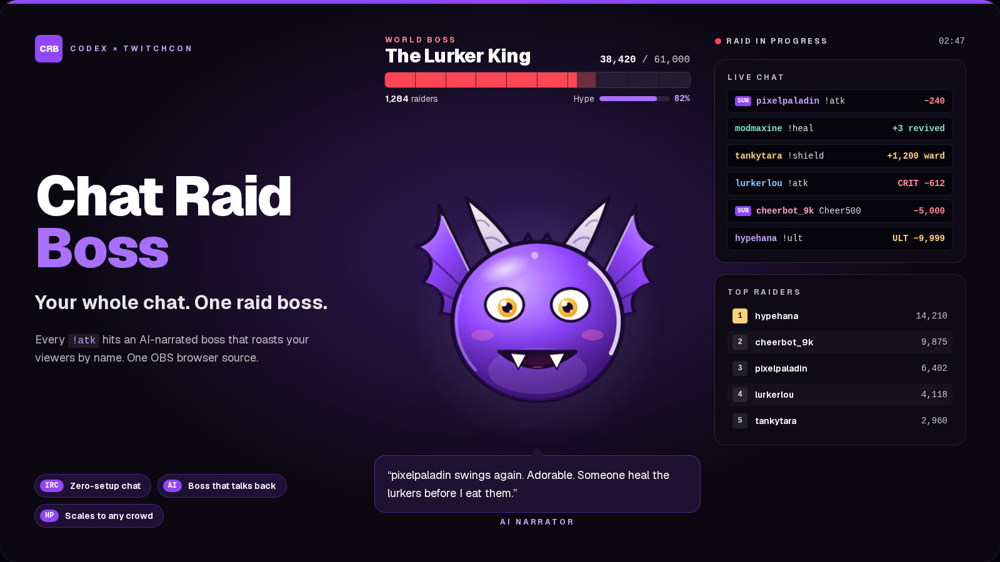
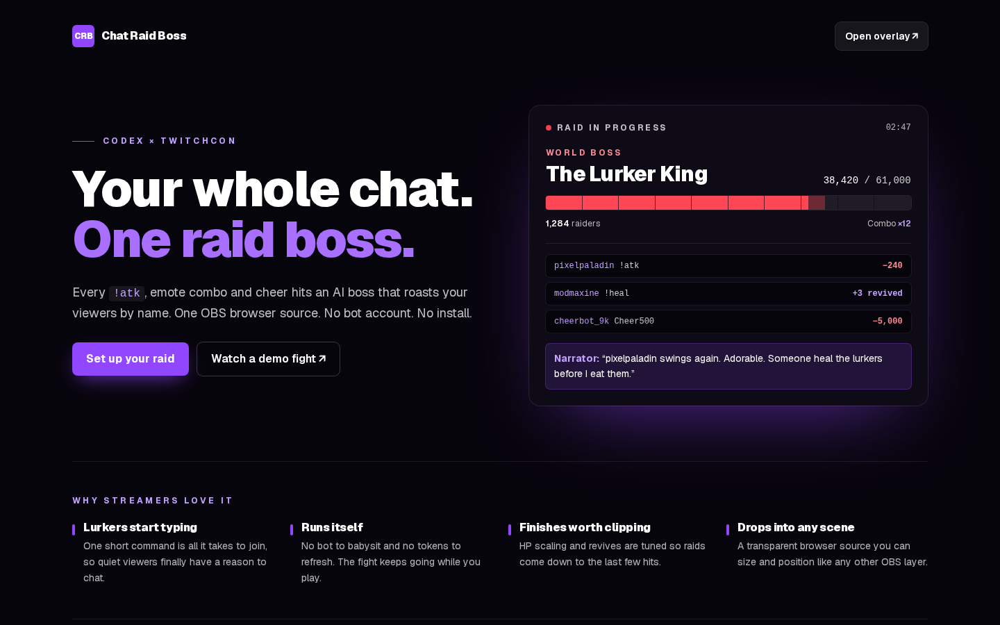
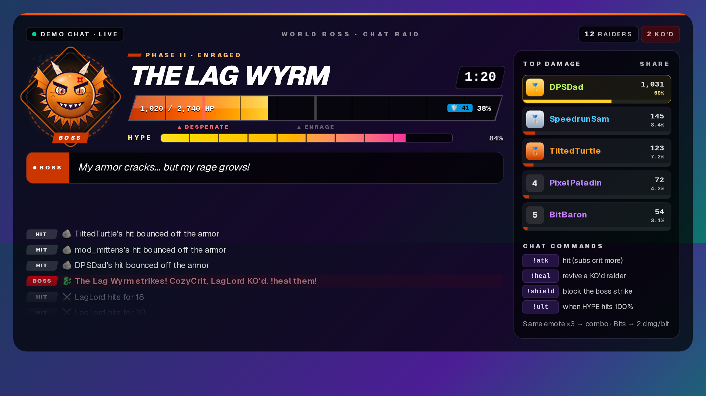
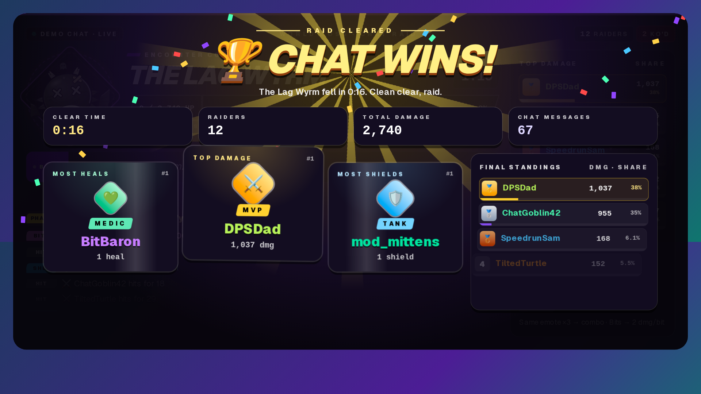

# Chat Raid Boss 🐉

**Your whole Twitch chat becomes one raid party.** Chat Raid Boss is a drop-in OBS browser-source overlay. Viewers fight an AI-narrated boss together:
- `!atk` to attack
- `!heal` to revive knocked-out friends
- `!shield` to block the boss's strike
- `!ult` to fire the raid ultimate when the HYPE meter is full
- Repeating the same emote builds combos, and bits deal big damage

The boss fights back on a timer by knocking out real chatters by name, and an AI narrator taunts the top raiders.

Built for the **Codex × TwitchCon Hackathon** (Devpost).






## Quick start

```bash
npm install
npm run dev          # http://localhost:3000
# production
npm run build && npm start
```

1. **Studio** (`/`):
   - Type a channel name or paste a twitch.tv link.
   - Pick a preset: Cozy, Standard, Hype train, or Mega raid. If Helix keys are set, the preset is chosen automatically from live viewer count.
   - Optionally open *advanced tuning*: base HP, +HP per raider, time limit, boss attack speed, per-user cooldown, and demo chat speed.
   - Test as a chatter, then click **Copy** to get the OBS URL.
2. **OBS:** Sources → + → Browser, width 1920, height 1080. Any 16:9 size works because the overlay scales from a fixed 1280-px design. The background is transparent. Tick "Control audio via OBS" to hear the sounds.

### Overlay URL parameters
| Param | Meaning | Range |
|---|---|---|
| `channel` | Twitch login to read chat from | `a-z0-9_`, 25 chars |
| `demo=1` | simulated chat instead of a channel | |
| `boss` | boss name | 30 chars |
| `hp` / `scale` | base HP / extra HP per new raider | 500–1M / 0–5000 |
| `dur` / `atk` / `cd` | time limit (s) / boss attack interval (s) / per-user cooldown (ms) | 30–1800 / 3–60 / 0–30000 |
| `sound=0` | mute synthesized SFX | |
| `wait=1` | don't autostart; a mod types `!raid start` (and `!raid reset`) | |
| `eventsub=1` | Channel Points power-ups (needs server env, see below) | |
| `layout=compact` | 520×236 corner widget (top-right) instead of the full arena; also a Studio toggle | |

Every value is validated and clamped (`src/lib/config.ts`), so a bad URL can never break the overlay.

## Extra pages and assets

| Route | What it is |
|---|---|
| `/commands` | Viewer guide to every chat command (link it in your panels) |
| `/obs` | Illustrated step-by-step OBS setup guide |
| `/r?boss=…&outcome=…` | Shareable raid result page with Open Graph / Twitter card |
| `/api/result-card` | 1200×630 result card image (PNG) |
| `/panel?variant=play\|commands\|bits` | 320×160 Twitch channel panel images |
| `/press`, `/press/how`, `/press/features` | Press / pitch slides |
| `/press/storyboard` | Demo-video storyboard and filmstrip |
| `/attract` | Self-running attract-mode demo loop for recording |
| `/overlay/cheatsheet` | Command cheat-sheet overlay for OBS |
| `/overlay?layout=compact` | Compact corner widget layout |
| `/panel` | Twitch panel image (PNG) |

There are 9 built-in bosses, each with its own art: Lag Wyrm, Buffer Lich, Copypasta and Ban Hammer, plus five seasonal bosses including Gift Goblin, Neon Glitch and Lunar Dragon. The Studio has a streamer kit with panel downloads and a result-card share link.

## Modes

| Mode | What you need | What works |
|---|---|---|
| Demo | nothing | Simulated chatters, the full game, canned boss lines |
| Live chat | a channel name | Real Twitch chat from any public channel over Twitch's IRC WebSocket. Uses an anonymous read-only `justinfan` login, so no OAuth and no bot account. Reconnects with exponential backoff. |
| + Helix | `TWITCH_CLIENT_ID`, `TWITCH_CLIENT_SECRET` | Channel avatar, live status and viewer count, and preset auto-pick |
| + Channel Points | also `TWITCH_USER_TOKEN` (broadcaster, `channel:read:redemptions`) | **EventSub WebSocket**. The server creates the `channel.channel_points_custom_reward_redemption.add` subscription, so the token never reaches the overlay. Reward titles containing *smite*, *revive*, or *freeze* trigger power-ups. |
| + AI narrator | `OPENAI_API_KEY` (optional `OPENAI_MODEL`, default `gpt-6-astra`) | In-character taunts from the OpenAI Responses API. 6s client timeout, never more than one request in flight, a per-IP rate limit, and canned fallback lines. |

Copy `.env.example` to `.env.local`. `GET /api/health` shows which integrations are active. Every integration degrades gracefully.

## Gameplay
- **Attack:** `!atk` / `!attack` / `!hit` / `!a` deals 18–34 damage. Crit chance is 12%, or 25% for subs, and a crit does ×3.
- **Heal and revive:** `!heal` / `!revive` revives the top KO'd damage dealer.
- **Shield:** `!shield` / `!block` cancels boss targets.
- **Ultimate:** `!ult` deals 12% of max HP when HYPE reaches 100%. Hype comes from hits, crits, combos, revives, and bits.
- **Emote combos:** the same emote 3+ times within 4s deals 40 × combo damage. **Bits** deal 2 damage per bit, capped, and ignore cooldowns and KOs.
- **Anti-spam:** each user has a cooldown (default 1.2s). Ignored spam is counted, not punished. Emotes are exempt so combos stay fun.
- **Scaling:** each new raider adds HP (default +150). The boss KOs one extra raider per 25 active chatters, so 10 viewers and 10,000 both get a close fight.
- **Phases:** Fight → **ENRAGED** at 50% HP (faster attacks) → **DESPERATE** at 20%, each with a banner and new boss art. Chat wins at 0 HP; the boss wins when time runs out.
- **End screen:** confetti, fight time, MVP (damage), Medic (heals), and Tank (shields).

## Juice (fun to watch)
- SVG dragon boss that changes color and face by phase and flashes on hits.
- Floating damage numbers and particle bursts.
- An HP bar with a ghost "damage trail", screen shake on crits and strikes, phase banners, and an urgent timer in the last 20s.
- Web Audio synthesized SFX (no asset downloads). The studio starts muted with a 🔇/🔊 toggle; the overlay is on unless `sound=0`.
- Respects `prefers-reduced-motion`.

## Architecture
```
src/lib/game.ts          Pure engine: applyMessages(state, batch), tick, applyRedemption, awards; injectable RNG
src/lib/commands.ts      Command parser + aliases + emote detection
src/lib/config.ts        URL <-> config with clamping (shared by studio and overlay)
src/lib/useRaid.ts       Hook: chat → bounded queue (500) → one batch per animation frame → engine; SFX; narrator
src/lib/twitchChat.ts    IRC-over-WebSocket client (tags, PING/PONG, backoff reconnect)
src/lib/eventsub.ts      EventSub WebSocket client (session_welcome, keepalive, reconnect)
src/lib/sfx.ts           Web Audio synth, throttled
src/lib/color.ts         Lifts dark chat colors to stay legible
src/components/          Arena (overlay UI), BossArt, Studio, ErrorBoundary (auto-recovers)
src/app/api/             narrate (OpenAI), twitch/user (Helix), eventsub/subscribe, health
```

**Performance and robustness:**
- The engine clones state once per frame batch, not once per message.
- Players are capped at 5,000, the feed at 30, and pops at 14.
- In tests, 50,000 messages from 7,000 chatters process in under 1s.
- The overlay holds about 59 fps at 1920×1080 in headless Chromium. Removing `backdrop-filter` raised it from 17 fps.

## Quality
```bash
npm run lint && npm run typecheck   # clean
npm test                            # Vitest: 22 engine/parser/config tests
npm run build && npm start &
BASE_URL=http://localhost:3000 npm run smoke   # Playwright: APIs, studio, transparent overlay, fps, end screen, no console errors
```

Results:
- axe-core: 0 violations on 13 pages: studio, full and compact overlay, cheat sheet, /r, /obs, /commands, all four press pages, /attract and the 404 page. (`/panel` is a PNG.)
- Lighthouse on `/`: performance 98, accessibility 100, best practices 100, SEO 100 (LCP 1.3s, CLS 0, TBT 110ms).
- Overlay: 60fps at 1080p in both the full and compact layouts.
- Lighthouse on the studio (mobile, throttled): Performance 93, Accessibility 100, Best Practices 100, SEO 100.

## Deploy
`npx vercel` (or import the repo), then add the env vars. No database is needed.

## Design credits

The overlay HUD, studio, landing page, boss art and variants, raid intro, compact widget, result card, Twitch panels, streamer kit, OBS guide, viewer guide, press slides, storyboard, attract mode, cheat sheet, seasonal bosses, OG images and error pages were designed with v0 (v0-max), then hand-integrated and checked against the engine tests, the smoke suite (60fps at 1080p) and axe.

## Screenshots

- `screenshots/00-hero.png`
- `screenshots/01-studio-lobby.png`
- `screenshots/02-studio-raid-in-progress.png`
- `screenshots/03-cheer-hit.png`
- `screenshots/04-obs-overlay.png`
- `screenshots/05-mobile.png`
- `screenshots/06-live-channel.png`
- `screenshots/07-overlay-1080p-over-stream.png`
- `screenshots/08-end-screen-awards.png`
- `screenshots/09-og-image.png`
- `screenshots/10-press-hero.png`
- `screenshots/11-how-it-works.png`
- `screenshots/12-features.png`
- `screenshots/13-not-found.png`
- `screenshots/14-commands.png`
- `screenshots/15-result-card.png`
- `screenshots/16-twitch-panels.png`
- `screenshots/17-obs-guide.png`
- `screenshots/18-streamer-kit.png`
- `screenshots/19-landing-tools.png`
- `screenshots/20-compact-overlay.png`
- `screenshots/21-cheatsheet-overlay.png`
- `screenshots/22-settings-io.png`
- `screenshots/23-raid-recap.png`
- `screenshots/24-victory-burst.png`
- `screenshots/25-seasonal-bosses.png`
- `screenshots/26-attract.png`
- `screenshots/27-storyboard.png`
- `screenshots/28-boss-roster.png`
